<h1 align="center">Aara: The Sawmill Manager for India</h1>

<p align="center"><b>Stock in CFT, estimates with GST, real profit, labour attendance, timber auctions and WhatsApp updates.</b> One app for the whole mill, in 13 Indian languages. Works offline.</p>

<p align="center">
  
</p>

<p align="center">
  <b>An app by Akshay Dubey for sawmill (aara mill) owners, partners and munshis.</b><br>
  Runs on a phone, tablet or computer. <b>Your mill's data stays on your device unless you switch on cloud sync.</b>
</p>

<p align="center">
  <a href=".github/workflows/test.yml"></a>
  
  
  
  
  
</p>

<p align="center">
  <a href="#-quick-start">Quick Start</a> ·
  <a href="#-what-you-get">Features</a> ·
  <a href="#-a-quick-tour">Tour</a> ·
  <a href="#-how-the-numbers-work">How the numbers work</a> ·
  <a href="#-how-it-works">How it works</a> ·
  <a href="#-privacy-and-safety">Privacy</a> ·
  <a href="#-repository-layout">Layout</a>
</p>

<p align="center">
  <a href="docs/images/02-home.png">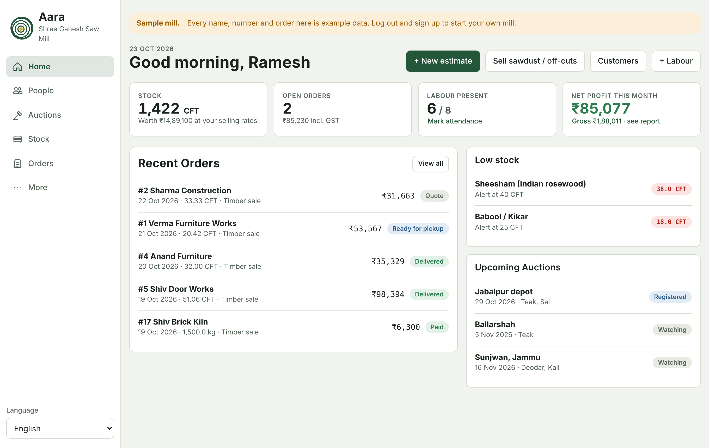</a><br>
  <sub><i>The home screen of the sample mill: stock in CFT and its value, open orders, who is at work today, and this month's net profit.</i></sub>
</p>

---

## ✨ What you get

- **Every estimate in seconds.** Enter sawn sizes (length in feet × width and thickness in inches), round logs by girth (Hoppus or true volume) or running feet. Aara works out CFT, suggests a rate, adds GST and gives you a total.
- **Profit you can trust.** Aara keeps a weighted-average landed cost for every wood, counts sawing loss, and locks the cost when an order is confirmed. You see the profit on every order and a full monthly profit and loss.
- **Price it your way.** A margin slider, per-wood margins, list rates or cost + margin, round to ₹10, and a helper for when the customer asks for a lower price: it shows the discount, your new profit, and your walk-away price. Aara warns you before you confirm an order at a loss.
- **Stock that stays honest.** 48 Indian and imported timbers with Hindi names. Logs and sawn stock in CFT, low-stock alerts and an in/out ledger. Confirming an order deducts stock once; editing, cancelling or deleting puts it right.
- **Sawdust and off-cuts are money too.** Sell sawdust (buradaa), firewood slabs, short pieces (tukde), chips and bark by kg, quintal, tonne, bag, trolley or CFT, each with its own GST and HSN.
- **Letterhead estimates.** Your logo, colours, address, bank and UPI details, HSN codes, amount in words and your terms, as a PDF or printout. Your costs and margins never appear on what the customer sees.
- **Owners, partners and labour.** Profiles with shares, daily, monthly or piece-rate wages, a monthly attendance register (present, half day, absent, leave), advances (kharchi) and wages paid.
- **Customers and dues.** Customers are saved from every estimate. See each one's orders, business, profit and what they still owe, and record payments.
- **WhatsApp updates.** Send the estimate, order confirmed, ready for pickup, payment reminders, new stock rates or festival greetings through WhatsApp or WhatsApp Business, in English or Hindi.
- **Timber auctions.** How forest-depot auctions work in HP, J&K, MP, Maharashtra, Kerala, AP, Haryana, UP and West Bengal, plus your own auction diary with EMD and status.
- **Your data, safe.** Automatic backups every day, 7, 15 or 30 days, restore, import and export, Excel files, and a data check and repair tool.
- **13 languages.** English, Hindi, Marathi, Gujarati, Punjabi, Bengali, Tamil, Telugu, Kannada, Malayalam, Odia, Assamese and Urdu.

## 🚀 Quick Start

Download or clone this repository. Aara is plain web files with no build step.

| | How | What happens |
|---|---|---|
| **Any browser** | Run `python3 -m http.server 8000` in this folder, then open `http://localhost:8000` | Aara opens. Sign up with your mobile number and a PIN, or try the sample mill. |
| **Phone home screen** | Open the hosted site, then **Add to Home Screen** | Aara installs like an app and works without internet after the first visit. |
| **Android app** | `npm install && npm run app:add && npm run app:sync && npm run app:android` | Opens the project in Android Studio to run on a phone or build for the Play Store. |
| **iPhone app** | `npm run app:ios` after the steps above | Opens the project in Xcode on a Mac. |

To host it for everyone, turn on **GitHub Pages** (Settings → Pages → Deploy from branch → `main` / root). Serve over `http://` or `https://`, not `file://`, so offline mode works.

> [!TIP]
> Open `http://localhost:8000/#demo` to jump straight into the sample mill. You can also link to a screen: `#demo/stock`, `#demo/orders`, `#demo/estimate` or `#demo/share`.

<details>
<summary><b>Native app details</b></summary>

The Android and iOS apps are thin [Capacitor](https://capacitorjs.com) shells around the same code. Inside the app, backups and PDFs are saved to the phone and shared through the phone's share sheet, so a letterhead PDF goes straight into WhatsApp. See [docs/app-build.md](docs/app-build.md).

Android needs Android Studio. iPhone needs Xcode on a Mac and an Apple Developer account to publish.
</details>

### First run

<p align="center">
  <a href="docs/images/01-signin.png">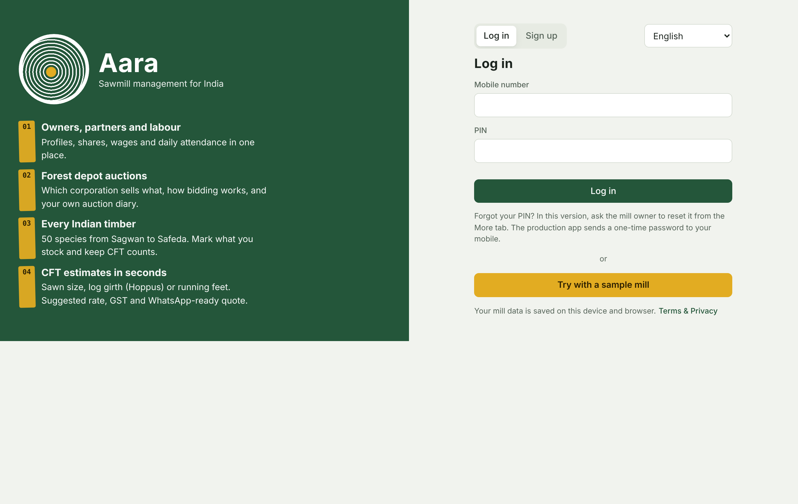</a><br>
  <sub><i>Sign up with your mill name, mobile number and a PIN. Terms and the privacy notice must be accepted; WhatsApp alerts are a separate, optional choice.</i></sub>
</p>

## 🖼️ A quick tour

<table>
  <tr>
    <td width="50%"><a href="docs/images/03-estimate.png">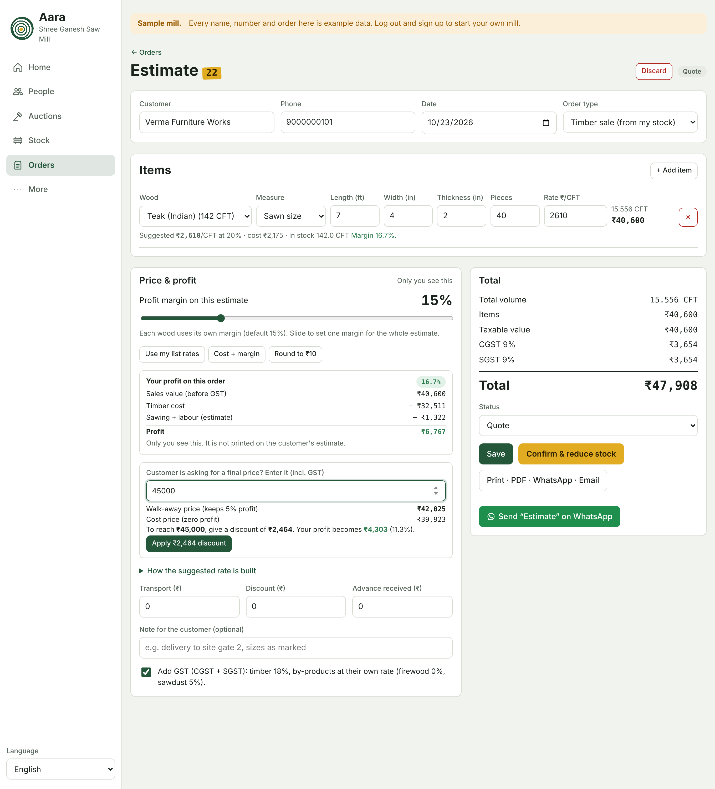</a><br><sub><b>Estimate.</b> CFT, suggested rate and margin per item, your profit, and what discount the customer's price would need.</sub></td>
    <td width="50%"><a href="docs/images/04-letterhead.png">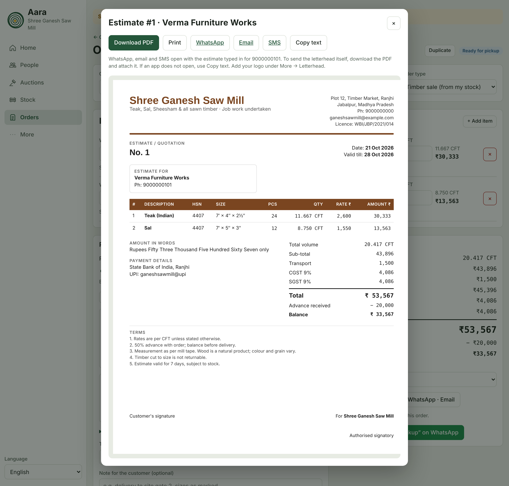</a><br><sub><b>Letterhead.</b> The customer's copy with HSN codes, CGST and SGST, amount in words and payment details.</sub></td>
  </tr>
  <tr>
    <td width="50%"><a href="docs/images/05-profit.png">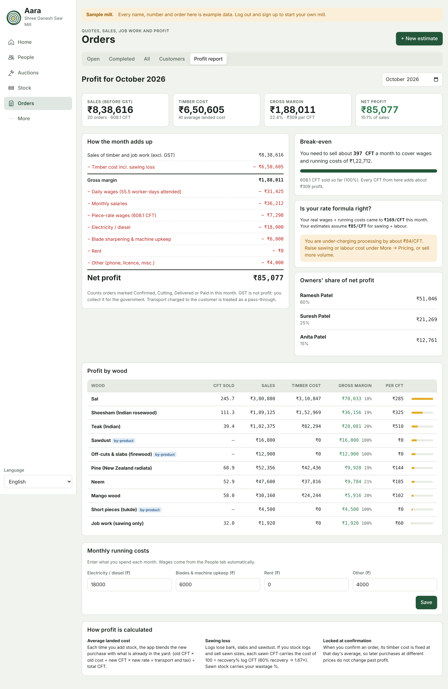</a><br><sub><b>Profit report.</b> Sales, timber cost, wages and running costs, break-even CFT, profit by wood and each owner's share.</sub></td>
    <td width="50%"><a href="docs/images/06-attendance.png">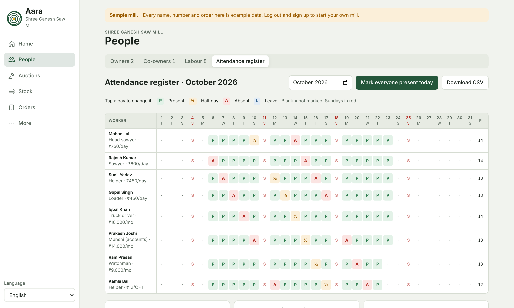</a><br><sub><b>Attendance.</b> Tap a day for present, half day, absent or leave. Wages and advances add up on their own.</sub></td>
  </tr>
  <tr>
    <td width="50%"><a href="docs/images/07-byproducts.png">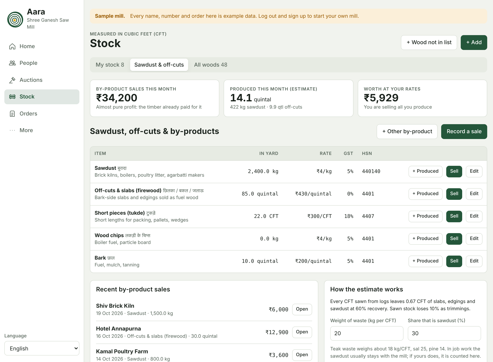</a><br><sub><b>Sawdust and off-cuts.</b> Yard stock, quick sales, and how much your sawing should be producing.</sub></td>
    <td width="50%"><a href="docs/images/08-customers.png">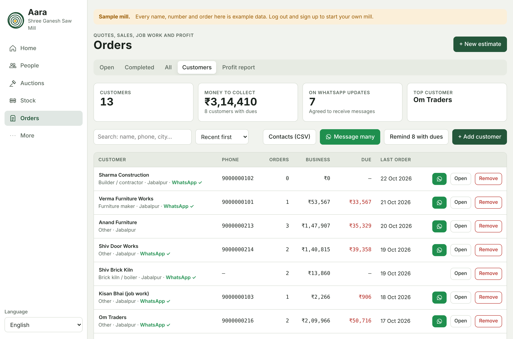</a><br><sub><b>Customers.</b> Orders, business and dues for every customer, with one-tap WhatsApp.</sub></td>
  </tr>
  <tr>
    <td width="50%"><a href="docs/images/09-whatsapp.png">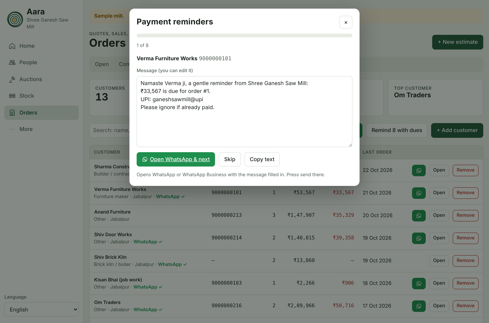</a><br><sub><b>WhatsApp.</b> Payment reminders for everyone who owes you, one chat after another, each message ready to send.</sub></td>
    <td width="50%"><a href="docs/images/10-backup.png">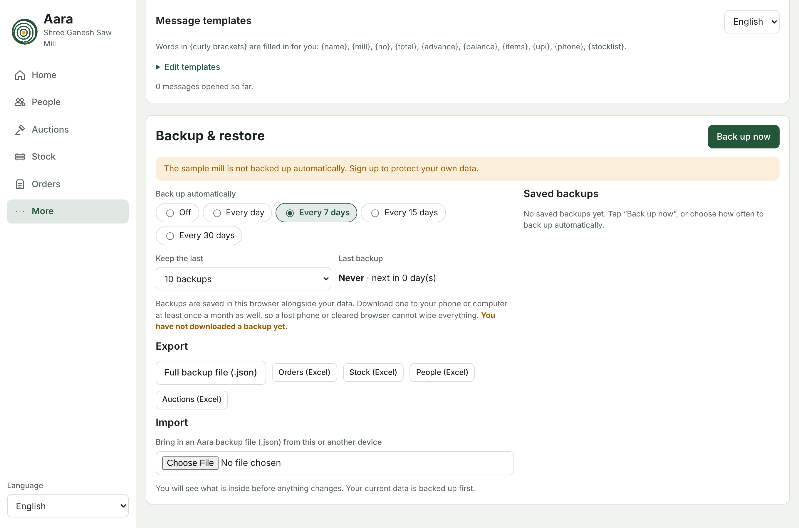</a><br><sub><b>Backup.</b> Automatic backups, restore, import and Excel exports.</sub></td>
  </tr>
</table>

<p align="center">
  <a href="docs/images/11-mobile-home.png">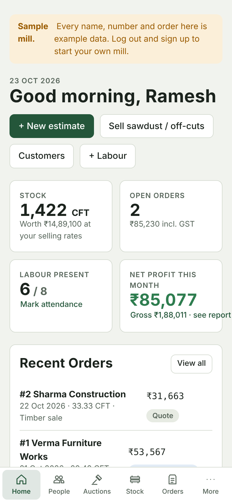</a>
  &nbsp;&nbsp;
  <a href="docs/images/12-mobile-estimate.png">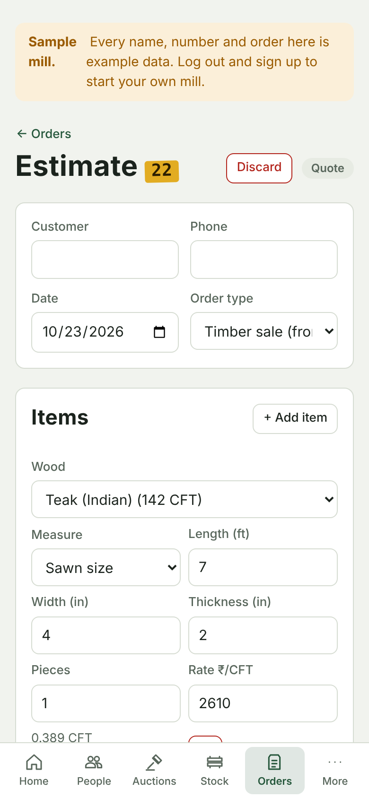</a><br>
  <sub><i>Built for phones first: big buttons, a bottom tab bar and screens that fit cheap Android handsets.</i></sub>
</p>

## 🧮 How the numbers work

| What | Formula | Example |
|---|---|---|
| **Sawn timber** | Length (ft) × Width (in) × Thickness (in) ÷ 144 × pieces | 7′ × 4″ × 2½″ = 0.486 CFT per piece |
| **Round log (Hoppus)** | (Girth in inches ÷ 4)² × Length (ft) ÷ 144 | The trade's quarter-girth rule, which allows for bark and wane |
| **Running feet** | Length (ft) × pieces | Frames, battens and beading of a fixed section |
| **Average landed cost** | (old CFT × old cost + new CFT × new rate + transport and tax) ÷ total CFT | Updated every time you add stock |
| **Sawing loss** | Logs sold as sawn sizes cost 100 ÷ recovery % of the log rate | 60% recovery → 1.67 × log rate |
| **Suggested rate** | (landed cost + sawing loss + sawing + labour) × (1 + margin) | Rounded up to ₹5 |
| **GST** | Timber (HSN 4403, 4407) at 18%; sawdust 5%; firewood 0% | CGST + SGST in your state, IGST outside it |

Confirming an order locks its timber cost at that day's average, so buying wood later at a different price does not change past profit. Wood rates in the app are indicative ranges; set your own.

## 🧭 How it works

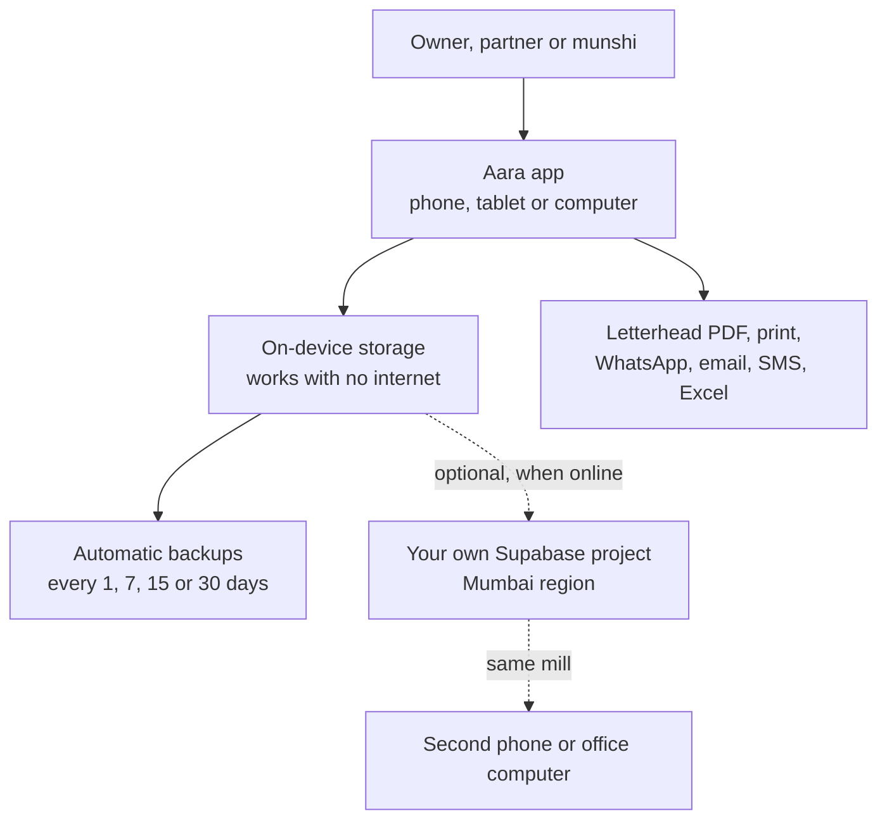

Everything is saved on the device first. Cloud sync is optional: switch it on and the same mill opens on a second phone or a computer, with roles for owner, partner and munshi. Each record syncs on its own, so two people working at once don't overwrite each other, and the server checks what a munshi is allowed to change. See [docs/sync-setup.md](docs/sync-setup.md).

## 🔒 Privacy and safety

- **Your data stays with you.** Without sync, everything lives on your device. With sync, it goes to your own Supabase project, not ours.
- **PIN protected.** PINs are stored hashed, with a lockout after repeated wrong attempts.
- **Costs stay in the office.** Estimates, PDFs and WhatsApp messages never show your cost, margin, break-even or stock levels. The test suite checks this.
- **Workers' privacy.** Only the last 4 digits of Aadhaar are stored, and you confirm each worker agreed to be recorded.
- **Consent for messages.** Bulk WhatsApp messages only go to customers who agreed to receive them.
- **Built for India's data law.** The sign-up flow and privacy notice follow the Digital Personal Data Protection Act, 2023.
- **Nothing is lost by accident.** Restoring a backup or importing a file saves your current data first.

## 📁 Repository layout

| Path | What it is |
|---|---|
| `index.html` | The whole app: screens, styles and logic. No build step, no runtime dependencies. |
| `sw.js` | Service worker that keeps the app working offline. |
| `sync.js` | Optional cloud sync, loaded only when it's set up. |
| `supabase/schema.sql` | One-time database setup for sync, with security rules. |
| `vendor/` | PDF libraries, bundled so letterhead PDFs work offline. |
| `capacitor.config.json`, `scripts/` | Android and iOS app shells. |
| `test/run.mjs` | Automated tests that drive the real app functions. |
| `docs/` | [Blueprint](docs/blueprint.md), [sync setup](docs/sync-setup.md), [native app builds](docs/app-build.md) and images. |

<details>
<summary><b>Run the tests</b></summary>

```bash
node test/run.mjs     # or: npm test
```

No dependencies needed. Every push runs the suite on GitHub Actions.
</details>

<details>
<summary><b>Before public launch</b></summary>

1. A lawyer reviews the Terms and Privacy notice; fill in the company name and grievance officer.
2. Native speakers review the 13 translations.
3. Run `supabase/schema.sql` on a live project in the Mumbai region and test two phones at once (owner and munshi).
4. Build and test the Android and iPhone apps on real devices.
5. Confirm GST rates with an accountant and auction details with each forest corporation.
</details>

## 📄 License

Copyright © 2026 Akshay Dubey. All rights reserved.

Aara is an independent project and isn't affiliated with any state forest department or forest development corporation, Meta, WhatsApp or Supabase. Product names belong to their owners. Wood rates, GST rates and auction details are for guidance only; check them before you act.
